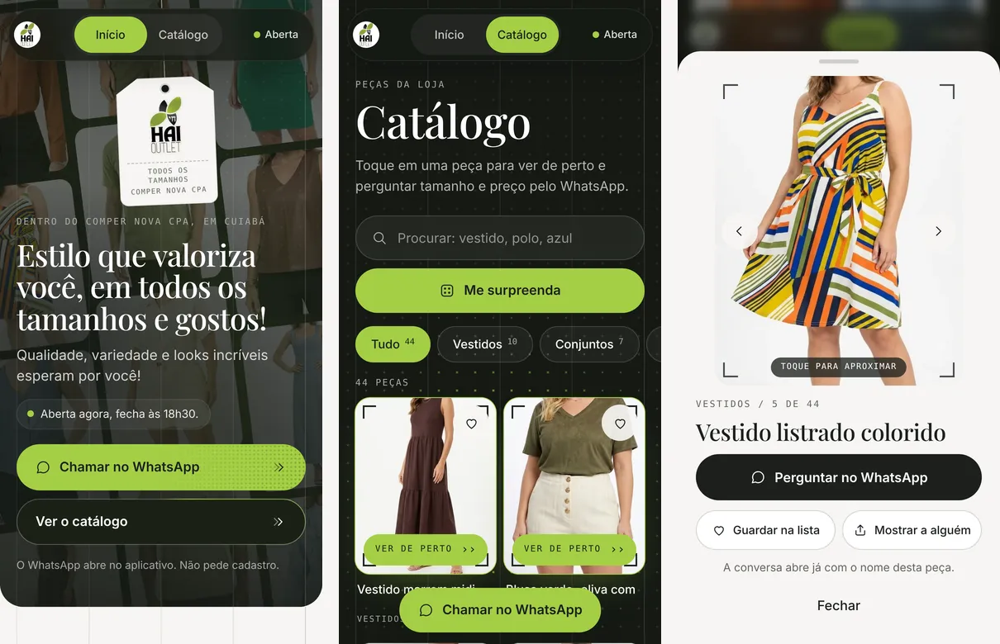

# Página da HAI OUTLET

Página da loja de roupas HAI OUTLET, que fica dentro do Supermercado Comper CPA, em Cuiabá. Ela abre quando a cliente encosta o celular no cartão de aproximação da loja, e também funciona como site comum em [lojahaioutlet.com.br](https://lojahaioutlet.com.br/).

Eu, Rodrigo Jr, fiz esta página pela [Mil e Uma Linhas!](https://mileumalinhas.com.br).

## O que a página faz

- Salva o contato da loja na agenda do celular.
- Abre o WhatsApp, o Instagram, o TikTok e a rota no mapa com um toque.
- Mostra se a loja está aberta agora e quanto falta para abrir ou fechar.
- Tem um catálogo de peças separado em Feminino, Masculino e Fitness, com busca, filtro por tipo e sorteio.
- Mostra todas as peças em uma vitrine que passa sozinha; tocar em uma abre essa peça no catálogo.
- Deixa a cliente marcar as peças de que gostou e mandar a lista inteira pelo WhatsApp.
- Aproxima a foto da peça com um toque.

## Como funciona

É uma página só, em HTML, CSS e JavaScript puros, sem instalar nada e sem servidor. O GitHub Pages entrega os arquivos.

| Arquivo | Para que serve |
|---|---|
| `dados.js` | Tudo o que muda: nome, telefone, horário, redes, endereço e a lista de peças. Para trocar uma informação da loja, é só mexer aqui. |
| `index.html` | A estrutura da página. |
| `cartao.css` | O visual e as animações. |
| `cartao.js` | O comportamento: horário, contato, catálogo, lista e gestos. |
| `contato.vcf` | O contato que vai para a agenda (nome e telefone). |
| `qr.svg` | O código da tela "Indicar a loja", que aponta para este endereço. |
| `fotos/` | Fotos das peças, recortadas sem mostrar o rosto de ninguém. |
| `video/` | O vídeo de tecido que fica no fundo do catálogo, com uma imagem parada para quem pede menos movimento. |
| `fonte/` | As duas fontes usadas (Playfair Display e Inter, licença OFL). |
| `CNAME` | Diz ao GitHub Pages qual é o domínio da página. |

## Privacidade

A página não tem cadastro, não usa cookies, não conta visitas e não guarda nada no aparelho. A lista de peças fica só na memória da tela e some ao fechar. O único conteúdo de fora é o mapa do Google, pedido só quando a pessoa rola até ele.

## Para trocar uma peça do catálogo

1. Coloque a foto em `fotos/`, em WebP, na proporção 4 por 5.
2. Acrescente uma linha na lista `catalogo` de `dados.js`, com o arquivo, o nome e o tipo (`v` vestidos, `c` conjuntos, `b` blusas, `m` masculino). Para a peça aparecer em Fitness, acrescente `grupo: 'x'` nela.

## Marcas, ofertas, preço e tamanho

O menu tem três telas: **Início**, **Catálogo** e **Ofertas**. Tudo é ligado pelos dados de `dados.js`, e cada recurso só aparece quando a loja informa o dado:

| Dado em `dados.js` | O que aparece |
|---|---|
| `grupoWhats` (link de convite) | Botão **Entrar no grupo do WhatsApp** no início |
| `marca` na peça | Fileira de marcas no catálogo e o nome da marca na peça |
| `marcaDestaque` | Bloco da marca no início, com atalho para o catálogo dela |
| `codigo` na peça | Código na ficha e na mensagem do WhatsApp |
| `de` e `por` na peça | Valor normal riscado e valor de venda; a peça entra em **Ofertas**, da maior economia para a menor |
| `tamanhos` na peça (`{ P: 1, M: 0 }`) | Botões de tamanho; `0` aparece riscado, como esgotado |
| peça com `tipo: 'a'` | Grupo **Acessórios** no catálogo |

Sem a lista de tamanhos, a ficha oferece PP, P, M, G e GG e avisa que a loja confirma na conversa. O tamanho escolhido e o código vão escritos na mensagem do WhatsApp. O site não tem ligação com o caixa da loja: disponível e esgotado valem pelo que foi informado por último. Os valores são informados pela loja.
